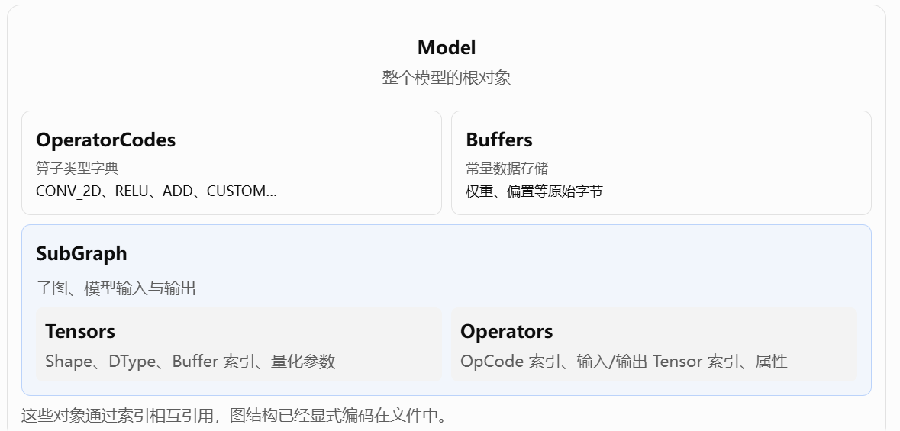
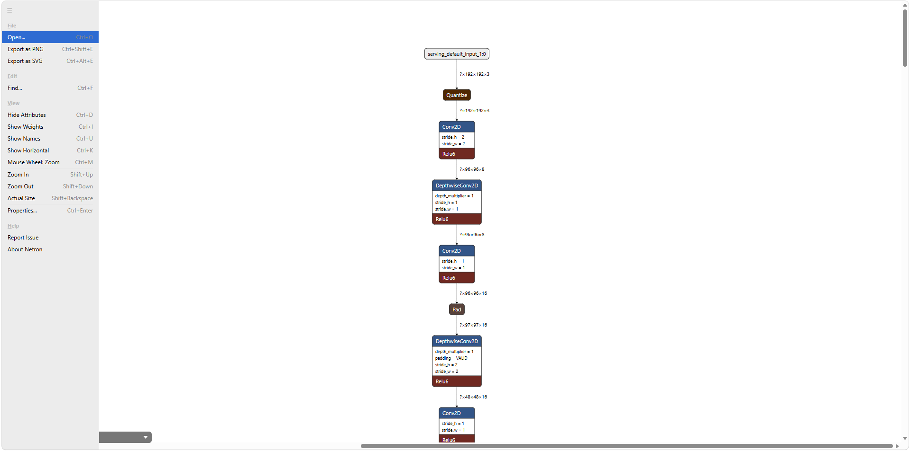
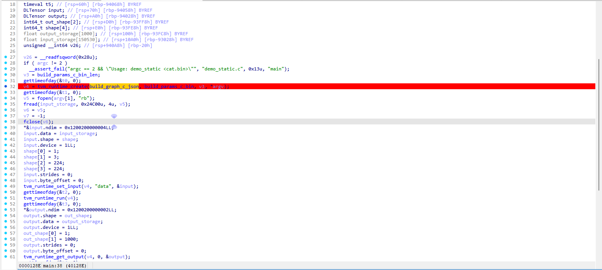

# Do DNN Binaries Really Need to Be Protected?

DNN(deep neural network,深度神经网络)在目标识别，图像分类等领域展现出强大的性能和优越性使得它被越来越广泛的应用，特别的，一系列edge device，例如手机，摄像头，门锁，无人机等包括但不限于IoT设备也在广泛地部署DNN模型。然而这也引发了一系列模型资产窃取的问题，how to protect DNN binarys on edge device是一个新的命题。

然而在研究how to protect DNN binary之前应该搞清楚针对这些DNN binarys具体是怎么部署的，相应的有哪些攻击面和攻击手段。

《Mind Your Weight(s): A Large-scale Study on Insufficient Machine Learning Model Protection in Mobile Apps》(USENIX Security'21)通过大规模实证研究揭示了一个重要问题：部署在手机端的机器学习模型虽然可能经过加密或混淆，但在现实应用中仍经常能够被窃取。作者分析了来自美国和中国 Android 应用市场的 46,753 个热门应用，建立静态分析工具 ModelXRay 来寻找应用中的机器学习模型并判断其保护情况，同时使用 ModelXtractor 进行动态分析，从运行中的应用内存中尝试提取解密后的模型。最终识别出 1,468 个使用设备端机器学习的应用。它分析的原始对象是 Android APK，而真正要窃取的是 `.tflite`、`.pb` 等序列化模型数据，不是通过分析 ARM 机器指令来恢复 DNN 计算语义。

## what is TFLite

穿插一点TFLite和PB等序列化模型结构的知识。

`.tflite` 和 `.pb` 本质上都是序列化的计算图（Serialized Computational Graph）。它们不仅保存模型权重，还直接保存算子类型、张量形状、算子间的连接关系以及计算所需的属性。最关键的一点是：这些格式并不需要保存模型的 Python 源码，也不需要包含算子的机器指令，就能够完整描述一个可执行的 DNN。

我们拿一个简单的 CNN 来看。

假设有一个模型：
$$
 Y=\operatorname{ReLU}(\operatorname{Conv2D}(X,W,b)) 
$$
要让推理框架执行它，至少需要五类信息：

| 信息        | 示例                    | 作用               |
| ----------- | ----------------------- | ------------------ |
| 算子类型    | `CONV_2D`、`RELU`       | 知道执行什么计算   |
| 拓扑关系    | Conv2D 的输出连接 ReLU  | 知道计算顺序与依赖 |
| Tensor 描述 | `float32[1,28,28,1]`    | 知道数据类型、形状 |
| 算子属性    | stride=1、padding=VALID | 知道具体计算配置   |
| 参数数据    | 卷积权重 W、偏置 b      | 提供模型参数       |

有了这些信息，再配合一个实现了对应算子的 Runtime，就可以执行完整推理。

TFLite 使用 Google 的 FlatBuffers 格式。它有公开的 Schema，定义了文件中每类对象的布局。官方 Schema 可以参考：[TensorFlow Lite Schema](https://github.com/tensorflow/tensorflow/tree/master/tensorflow/lite/schema)。

核心数据结构如下：



类似于[netron](https://netron.app/)这样的网站提供了对于tflite格式文件的可视化解析。[netron Github地址](https://github.com/lutzroeder/netron)



我们可以把TFLite这种格式的文件理解为一个graph,描述了一个模型怎么运行，具体运行时还有一个interpreter去解释这个图，所以我们把这种模式称为**解释型运行**，他最大的问题就是这个graph的数据结构很容易被定位，无论是静态分析去定位还是动态去内存里dump(针对加密/混淆后的模型)目的都是为了获得这个数据结构，不需要耗费力气去逆向一个binary里承担的计算语义。

### TFLite with interpreter

拿一个实际部署binary来说。

```cpp
int __fastcall main(int argc, const char **argv, const char **envp)
{
  int v4; // ebp
  _DWORD *v5; // rax
  void *v6; // r12
  const char *v7; // rdi
  FILE *v8; // rax
  int v9; // edx
  int v10; // ecx
  int v11; // r8d
  int v12; // r9d
  FILE *v13; // rbx
  bool v14; // r13
  __int64 v15; // rax
  __int64 v16; // r13
  __int64 v17; // r15
  __int64 v18; // rbx
  void (__fastcall *v19)(__int64, __int64, __int64); // rax
  __int64 v20; // rsi
  __int64 v21; // rdi
  int v22; // edx
  int v23; // ecx
  int v24; // r8d
  int v25; // r9d
  int v26; // r13d
  __int64 v28; // rdx
  unsigned __int64 v29; // rax
  __int64 v30; // rax
  void *v31; // rdi
  __int64 v32; // rdx
  unsigned __int64 v33; // rax
  __int64 v34; // rax
  float *v35; // r15
  size_t v36; // r13
  FILE *v37; // rax
  FILE *v38; // rbp
  size_t v39; // r14
  unsigned __int8 v40; // bp
  __int64 v41; // [rsp+0h] [rbp-1C8h] BYREF
  tflite::Interpreter *v42; // [rsp+8h] [rbp-1C0h] BYREF
  __int64 (__fastcall **v43)(); // [rsp+10h] [rbp-1B8h] BYREF
  int v44; // [rsp+18h] [rbp-1B0h]
  __int64 v45; // [rsp+20h] [rbp-1A8h]
  __int64 v46; // [rsp+28h] [rbp-1A0h]
  int v47; // [rsp+30h] [rbp-198h]
  int v48; // [rsp+38h] [rbp-190h]
  int v49; // [rsp+40h] [rbp-188h]
  __int64 v50; // [rsp+48h] [rbp-180h]
  int v51; // [rsp+50h] [rbp-178h]
  __int64 v52; // [rsp+58h] [rbp-170h]
  __int64 v53; // [rsp+60h] [rbp-168h]
  _BYTE v54[200]; // [rsp+C0h] [rbp-108h] BYREF
  unsigned __int64 v55; // [rsp+188h] [rbp-40h]
  int v56; // [rsp+1D0h] [rbp+8h]
  int v57; // [rsp+1D8h] [rbp+10h]
  int v58; // [rsp+1E0h] [rbp+18h]
  int v59; // [rsp+1E8h] [rbp+20h]
  int v60; // [rsp+1F0h] [rbp+28h]
  int v61; // [rsp+1F8h] [rbp+30h]
  int v62; // [rsp+200h] [rbp+38h]
  int v63; // [rsp+208h] [rbp+40h]
  int v64; // [rsp+210h] [rbp+48h]
  int v65; // [rsp+218h] [rbp+50h]
  int v66; // [rsp+220h] [rbp+58h]
  int v67; // [rsp+228h] [rbp+60h]
  int v68; // [rsp+230h] [rbp+68h]
  int v69; // [rsp+238h] [rbp+70h]
  int v70; // [rsp+240h] [rbp+78h]
  int v71; // [rsp+248h] [rbp+80h]
  int v72; // [rsp+250h] [rbp+88h]
  int v73; // [rsp+258h] [rbp+90h]
  int v74; // [rsp+260h] [rbp+98h]
  int v75; // [rsp+268h] [rbp+A0h]
  int v76; // [rsp+270h] [rbp+A8h]
  int v77; // [rsp+278h] [rbp+B0h]
  int v78; // [rsp+280h] [rbp+B8h]
  int v79; // [rsp+288h] [rbp+C0h]
  int v80; // [rsp+290h] [rbp+C8h]
  int v81; // [rsp+298h] [rbp+D0h]
  int v82; // [rsp+2A0h] [rbp+D8h]
  int v83; // [rsp+2A8h] [rbp+E0h]
  int v84; // [rsp+2B0h] [rbp+E8h]
  int v85; // [rsp+2B8h] [rbp+F0h]
  int v86; // [rsp+2C0h] [rbp+F8h]
  int v87; // [rsp+2C8h] [rbp+100h]
  int v88; // [rsp+2D0h] [rbp+108h]
  int v89; // [rsp+2D8h] [rbp+110h]
  int v90; // [rsp+2E0h] [rbp+118h]
  int v91; // [rsp+2E8h] [rbp+120h]
  int v92; // [rsp+2F0h] [rbp+128h]
  int v93; // [rsp+2F8h] [rbp+130h]
  int v94; // [rsp+300h] [rbp+138h]
  int v95; // [rsp+308h] [rbp+140h]
  int v96; // [rsp+310h] [rbp+148h]
  int v97; // [rsp+318h] [rbp+150h]
  int v98; // [rsp+320h] [rbp+158h]
  int v99; // [rsp+328h] [rbp+160h]
  int v100; // [rsp+330h] [rbp+168h]
  int v101; // [rsp+338h] [rbp+170h]
  int v102; // [rsp+340h] [rbp+178h]
  int v103; // [rsp+348h] [rbp+180h]
  __int64 v104; // [rsp+350h] [rbp+188h]

  v55 = __readfsqword(0x28u);
  if ( argc != 3 )
  {
    v4 = 2;
    __fprintf_chk(_bss_start, 2, "usage: %s input.f32 output.f32\n", *argv);
    return v4;
  }
  v4 = 3;
  v5 = (_DWORD *)operator new(0x6000u);
  *v5 = 0;
  v6 = v5;
  memset(v5 + 1, 0, 0x5FFCu);
  v7 = argv[1];
  v8 = fopen(v7, "rb");
  v13 = v8;
  if ( v8 )
  {
    v14 = 0;
    if ( fread(v6, 4u, 0x1800u, v8) == 6144 )
      v14 = fgetc(v13) == -1;
    fclose(v13);
    if ( !v14 )
    {
      __fprintf_chk(_bss_start, 2, "expected 6144 float32 values\n");
      v4 = 2;
      goto LABEL_16;
    }
    v15 = tflite::DefaultErrorReporter((tflite *)v13);
    tflite::FlatBufferModel::BuildFromBuffer(
      &v41,
      &embedded_tflite_model,
      "*ZN6tflite3ops7builtin17BuiltinOpResolverC4EvEUliE_" - (char *)&embedded_tflite_model,//第一步:引用嵌入 ELF 的 FlatBuffer
                                                // 
      v15);
    if ( !v41 )
    {
LABEL_14:
      std::unique_ptr<tflite::FlatBufferModel>::~unique_ptr(&v41);
LABEL_16:
      operator delete(v6, 0x6000u);
      return v4;
    }
    tflite::ops::builtin::BuiltinOpResolver::BuiltinOpResolver((tflite::ops::builtin::BuiltinOpResolver *)&v43);
    v16 = v46;
    v43 = &off_8316F0;
    v17 = v45;
    if ( v45 != v46 )
    {
      v18 = v45;
      do
      {
        while ( 1 )
        {
          v19 = *(void (__fastcall **)(__int64, __int64, __int64))(v18 + 16);
          if ( !v19 )
            break;
          v20 = v18;
          v21 = v18;
          v18 += 32;
          v19(v21, v20, 3);
          if ( v16 == v18 )
            goto LABEL_11;
        }
        v18 += 32;
      }
      while ( v16 != v18 );
LABEL_11:
      v46 = v17;
    }
    v42 = 0;
    tflite::InterpreterBuilder::InterpreterBuilder(v54, v41, &v43, 0);
    v26 = tflite::InterpreterBuilder::operator()(
            (unsigned int)v54,
            (unsigned int)&v42,
            v22,
            v23,
            v24,
            v25,
            v41,
            (_DWORD)v42,
            (_DWORD)v43,
            v44,
            v45,
            v46,
            v47,
            v48,
            v49,
            v50,
            v51,
            v52,
            v53);
    tflite::InterpreterBuilder::~InterpreterBuilder((tflite::InterpreterBuilder *)v54); //第二步:建立张量表、算子节点及函数绑定
    if ( !v26 )
    {
      tflite::Interpreter::SetNumThreads(v42, 1);
      if ( !(unsigned int)tflite::Interpreter::AllocateTensors(v42) ) //第三步:准备算子、规划和分配张量内存
      {
        v28 = **((_QWORD **)v42 + 13);
        v29 = **(int **)(v28 + 264);
        if ( (v29 & 0x80000000) != 0LL || v29 >= *(_QWORD *)(v28 + 40) )
          goto LABEL_35;
        v30 = *(_QWORD *)(v28 + 56) + 112 * v29;
        if ( *(_QWORD *)(v30 + 40) != 24576 )
          goto LABEL_13;
        v31 = 0;
        if ( *(_DWORD *)v30 == 1 )
          v31 = *(void **)(v30 + 8);
        memcpy(v31, v6, 0x6000u);
        if ( (unsigned int)tflite::Interpreter::Invoke(v42) ) //第四步:进入模型执行
          goto LABEL_13;
        v32 = **((_QWORD **)v42 + 13);
        v33 = **(int **)(v32 + 288);
        if ( (v33 & 0x80000000) != 0LL || v33 >= *(_QWORD *)(v32 + 40) )
LABEL_35:
          BUG();
        v34 = *(_QWORD *)(v32 + 56) + 112 * v33;
        if ( v34 )
        {
          if ( *(_DWORD *)v34 == 1 )
          {
            v35 = *(float **)(v34 + 8);
            if ( v35 )
            {
              v36 = *(_QWORD *)(v34 + 40);
              v37 = fopen(argv[2], "wb");
              v38 = v37;
              if ( v37 )
              {
                v39 = fwrite(v35, 1u, v36, v37);
                v40 = (v36 == v39) & (fclose(v38) == 0);
                __printf_chk(2, "output_bytes=%zu value=%.9g\n", v36, *v35);
                v4 = 2 * (v40 ^ 1);
              }
              else
              {
                perror(argv[2]);
                v4 = 2;
              }
            }
          }
        }
      }
    }
LABEL_13:
    std::unique_ptr<tflite::Interpreter>::~unique_ptr(&v42);
    v43 = &off_8316A8;
    tflite::MutableOpResolver::~MutableOpResolver((tflite::MutableOpResolver *)&v43);
    goto LABEL_14;
  }
 ''''''
}
```

#### 第一步，BuildFromBuffer 本身还没有执行网络。

这里传入的是：

```text
模型起始地址 = 0x831730;
模型字节数   = 6518384;
```

它建立一个引用这些字节的 FlatBufferModel 对象。此时模型的 shape、算子属性、权重和连接关系主要仍在原始 FlatBuffer 中。

#### 第二步，InterpreterBuilder 把图中的描述转换为可执行的运行时对象。

它主要建立两张表：

```text
张量表：
tensor编号 → TfLiteTensor
             ├─ shape
             ├─ dtype
             ├─ data指针
             └─ 量化等属性
```

```text
算子表：
node编号 → TfLiteNode + TfLiteRegistration
           ├─ 输入tensor编号
           ├─ 输出tensor编号
           ├─ 算子参数
           └─ prepare / invoke函数指针
```

例如，这个模型的第一层实际记录的是：

```text
node 0：CONV_2D

输入：
  tensor 3：图像   [1,32,32,6]
  tensor 2：权重   [20,5,5,6]
  tensor 0：偏置   [20]

输出：
  tensor 1：结果   [1,32,32,20]
```

Builder 从模型里读取这些编号和属性，建立对应对象，并通过算子注册表找到卷积实现。卷积的 padding、stride、激活等选项则被解析成 TfLiteConvParams，挂在 node->builtin_data 上。

实际负责这些工作的函数是：

```text
0x4f1db0  ParseTensors
0x4f0f40  ParseNodes
```

因此，连接关系可以是直接从模型图读取的。

#### 第三步，AllocateTensors 准备计算所需的内存。

它会调用算子的 prepare，检查类型和维度，确定输出及临时空间需求，再安排内存：

```text
权重、偏置：
    可以直接引用模型 buffer 中的常量

输入、中间结果、输出：
    安排可写内存

生命周期不重叠的中间结果：
    可以复用存储空间
```

完成后，TfLiteTensor.data 就能指向对应数据区域。

#### 第四步，复制输入，然后 Invoke() 逐节点执行。

我们这个 host 将输入文件中的数据复制到输入 tensor，再调用：

```cpp
interpreter->Invoke();
```

内部调度逻辑可以简化为：

```cpp
for (int node_id : execution_plan) {
    auto& node = nodes[node_id];
    auto& registration = registrations[node_id];
registration.invoke(&context, &node);
}
```

在当前 binary 中，真正调用算子的位置是：

```assembly
0x507c84  mov rax, [r9 + 0x68]   ; 取得 invoke 函数指针
...
0x507c96  mov rsi, r9            ; node
0x507c9e  call rax               ; 调用该节点的算子实现
```

卷积实现收到 context 和 node 后，按照输入输出编号取出张量，读取参数，再调用底层计算代码。

这里的算子实现是static link进binary的，和interpreter一起，这个ELF里面有：

```text
model
├── 模型数据：拓扑、shape、算子属性、权重
├── Interpreter：准备内存、调度节点
└── 原生算子代码：Conv、MaxPool、FullyConnected 等
```

#### 实际上的两层泄露

实际上我们可以关注到这里面其实存在了两层泄露，第一层是非常直观的**graph泄露**，例如TFLite with interpreter模式下他直接在ELF里包含了描述模型的TFLite格式数据，但是我们同样可以发现他在运行时调用一个kernel时同时也会显式地传递计算所需要的信息，例如一个kernel接受算子的维度，形状以及类型，我们把这第二种泄露称为**ABI泄露**。可以参考第二步里的张量表和算子表，他实际上是内存里对这个graph信息结构的描述，传递给底层算子实现用的。

在binary中：

```text
0x507630  Subgraph::Invoke：按执行计划调度
    │
    │ 0x507c9e: call rax
    │ 执行这个池化节点时，目标是 0x792f60
    ▼
0x792f60  MaxEval：池化算子的包装函数
    │
    │ 从 context/node 取得 TfLiteTensor 和池化参数
    │ 将张量 dims 转成 RuntimeShape
    │
    │ 0x793742: call 0x7923c0
    ▼
0x7923c0  optimized_ops::MaxPool：实际池化计算
```

MaxEval 的入口参数是：`MaxEval(TfLiteContext* context, TfLiteNode* node);`

它通过节点的输入、输出索引找到对应的 TfLiteTensor。信息分布如下：

| 需要的信息                          | 从哪里读取                                 |
| ----------------------------------- | ------------------------------------------ |
| 数据类型                            | TfLiteTensor.type                          |
| 数据地址                            | TfLiteTensor.data                          |
| rank、shape                         | TfLiteTensor.dims                          |
| 数据字节数                          | TfLiteTensor.bytes                         |
| 池化 stride、窗口大小、padding 类型 | node->builtin_data 指向的 TfLitePoolParams |
| 准备阶段算出的实际 padding          | 算子的内部状态，随后写入 PoolParams        |

### TFLite with interpreter-less

当然TFLite也有interpreter-less的部署模式，这种方式可以让他不使用解释器就可以直接部署。

《Model-less Is the Best Model: Generating Pure Code Implementations to Replace On-Device DL Models》(ISSTA'24)

核心思想是：通常，TensorFlow Lite 等端侧推理方案会在应用或设备中保存可识别的模型表示，这给模型提取、逆向工程和针对模型的攻击留下了入口。论文反过来提出：与其努力保护一个仍然存在的“模型文件”，不如解析模型、提取底层计算单元并生成实现同一计算过程的**纯代码程序**，从而让部署端不再需要显式保存原始模型。

CustomDLCoder 首先解析端侧 DL 模型及其计算结构，然后提取后端计算单元，将这些单元按照模型计算图进行配置，最终生成定制程序来执行推理。这样部署产物主要保留实际的数据计算逻辑，而不是一个需要在运行时解析的 `.tflite` 等模型表示；因此传统针对模型文件的嗅探和提取方式会更难直接奏效。

这就是我们期望看到的一种Standalone或者bundle的模式。

```cpp
dlnktu *__fastcall coder(__int64 a1, int a2)
{
  float *ThreadPoolDevice; // r12
  tflite::CpuBackendContext *v3; // rbx
  pmzjpl *v4; // r13
  pmzjpl *v5; // rbp
  float *v6; // rsi
  ydtzir *v7; // r12
  wztejd *v8; // rbp
  tflite::CpuBackendContext *v9; // rdx
  xcvkpr *v10; // r12
  tflite::CpuBackendContext *v11; // rdx
  dlnktu *v12; // rbp
  dlnktu *v13; // rbx

  ThreadPoolDevice = tflite::eigen_support::CreateThreadPoolDevice(0xFFFFFFFFLL, a2);
  v3 = operator new(0x28u);
  tflite::CpuBackendContext::CpuBackendContext(v3);
  tflite::CpuBackendContext::SetMaxNumThreads(v3, -1);
  v4 = mynbiq::mynbiq(a1, ThreadPoolDevice);	//函数名混淆后的算子	
  v5 = pmzjpl::pmzjpl(v4, ThreadPoolDevice);	//函数名混淆后的算子
  free(v4);
  v6 = ThreadPoolDevice;
  v7 = sgqeje::sgqeje(v5, ThreadPoolDevice);
  free(v5);
  v8 = ydtzir::ydtzir(v7, v6);
  free(v7);
  v10 = wztejd::wztejd(v8, v3, v9);
  free(v8);
  v12 = xcvkpr::xcvkpr(v10, v3, v11);
  free(v10);
  tflite::CpuBackendContext::~CpuBackendContext(v3);
  v13 = dlnktu::dlnktu(v12, v3);
  free(v12);
  return v13;
}
```

这是主要的模型调度结构，我们可以看到他已经没有了graph的读取和解析，而是直接调用实现的算子，是一种类似于aot的格式，虽然他关注到了第一种graph泄露，但是abi-level的泄露仍然存在

在binary中：

```text
0x4163e0  coder：整个模型的调度函数
    │
    │ 0x416431: call 0x4077a0
    ▼
0x4077a0  pmzjpl：第一层池化的包装函数
    │
    │ 构造形状、池化参数，分配输出内存
    │
    │ 0x407835: call 0x41c680
    ▼
0x41c680  optimized_ops::MaxPool：实际池化计算
```

外层调用相当于：

```cpp
output = pmzjpl(input_data);
```

但 pmzjpl 内部继续调用：

```cpp
MaxPool(
    pool_params,
    input_shape, input_data,
    output_shape, output_data
);
```

**所以外层只有裸数据指针，内层仍然出现形状和算子参数。**只不过底层计算库已经静态链接进同一个 ELF。

这里的pool_params仍然会暴露窗口、移动步长、边界偏移、输出截断范围等信息。

```assembly
.text:00000000004077A0 ; =============== S U B R O U T I N E =======================================
.text:00000000004077A0
.text:00000000004077A0
.text:00000000004077A0 ; void __fastcall pmzjpl::pmzjpl(pmzjpl *this, float *)
.text:00000000004077A0                 public _ZN6pmzjpl6pmzjplEPf
.text:00000000004077A0 _ZN6pmzjpl6pmzjplEPf proc near          ; CODE XREF: coder+51↓p
.text:00000000004077A0
.text:00000000004077A0 var_90          = qword ptr -90h
.text:00000000004077A0 var_88          = byte ptr -88h
.text:00000000004077A0 var_86          = dword ptr -86h
.text:00000000004077A0 var_7C          = xmmword ptr -7Ch
.text:00000000004077A0 var_64          = qword ptr -64h
.text:00000000004077A0 var_58          = dword ptr -58h
.text:00000000004077A0 var_50          = xmmword ptr -50h
.text:00000000004077A0 var_38          = dword ptr -38h
.text:00000000004077A0 var_30          = xmmword ptr -30h
.text:00000000004077A0 var_10          = qword ptr -10h
.text:00000000004077A0
.text:00000000004077A0 ; __unwind {
.text:00000000004077A0                 endbr64
.text:00000000004077A4                 push    rbx
.text:00000000004077A5                 sub     rsp, 90h
.text:00000000004077AC                 mov     rbx, fs:28h
.text:00000000004077B5                 mov     [rsp+98h+var_10], rbx
.text:00000000004077BD                 mov     rbx, rdi
.text:00000000004077C0                 mov     edi, 5000h      ; size
.text:00000000004077C5                 call    _malloc
.text:00000000004077CA                 mov     ecx, 2
.text:00000000004077CF                 lea     rsi, [rsp+98h+var_58]
.text:00000000004077D4                 mov     rdx, cs:qword_462728
.text:00000000004077DB                 movd    xmm0, ecx
.text:00000000004077DF                 mov     r8, rax
.text:00000000004077E2                 lea     rcx, [rsp+98h+var_38]
.text:00000000004077E7                 mov     [rsp+98h+var_90], rax
.text:00000000004077EC                 pshufd  xmm0, xmm0, 0
.text:00000000004077F1                 movups  [rsp+98h+var_7C], xmm0
.text:00000000004077F6                 movdqa  xmm0, cs:xmmword_462890
.text:00000000004077FE                 lea     rdi, [rsp+98h+var_88]
.text:0000000000407803                 mov     [rsp+98h+var_64], rdx
.text:0000000000407808                 movups  [rsp+98h+var_30], xmm0
.text:000000000040780D                 movdqa  xmm0, cs:xmmword_4628A0
.text:0000000000407815                 mov     rdx, rbx
.text:0000000000407818                 mov     [rsp+98h+var_86], 0
.text:0000000000407820                 mov     [rsp+98h+var_38], 4
.text:0000000000407828                 mov     [rsp+98h+var_58], 4
.text:0000000000407830                 movups  [rsp+98h+var_50], xmm0
.text:0000000000407835                 call    _ZN6tflite13optimized_ops7MaxPoolERKNS_10PoolParamsERKNS_12RuntimeShapeEPKfS6_Pf ; tflite::optimized_ops::MaxPool(tflite::PoolParams const&,tflite::RuntimeShape const&,float const*,tflite::RuntimeShape const&,float *)
.text:000000000040783A                 mov     rax, [rsp+98h+var_90]
.text:000000000040783F                 mov     rdx, [rsp+98h+var_10]
.text:0000000000407847                 sub     rdx, fs:28h
.text:0000000000407850                 jnz     short loc_40785B
.text:0000000000407852                 add     rsp, 90h
.text:0000000000407859                 pop     rbx
.text:000000000040785A                 retn
.text:000000000040785B ; ---------------------------------------------------------------------------
.text:000000000040785B
.text:000000000040785B loc_40785B:                             ; CODE XREF: pmzjpl::pmzjpl(float *)+B0↑j
.text:000000000040785B                 call    ___stack_chk_fail
.text:000000000040785B ; } // starts at 4077A0
.text:000000000040785B _ZN6pmzjpl6pmzjplEPf endp
```

**pool_params 就是从当前 rsp + 0x10 开始的那个栈对象。**

下面这条指令把它的地址放进第一个参数寄存器 rdi：

```assembly
0x4077FE  lea rdi, [rsp+98h+var_88]
```

因为 var_88 = -0x88，所以：

```text
rsp + 0x98 - 0x88 = rsp + 0x10
```

相关初始化共有三组。

第一组：设置四个 2，对应步长和窗口大小。

```assembly
0x4077CA  mov     ecx, 2
0x4077DB  movd    xmm0, ecx
0x4077EC  pshufd  xmm0, xmm0, 0
0x4077F1  movups  [rsp+98h+var_7C], xmm0
```

pshufd 把这个整数复制成：

```text
xmm0 = [2, 2, 2, 2]       // 四个 int32
```

写入地址为 rsp+0x1c，也就是 pool_params+0x0c：

| 相对 pool_params 的偏移 | 字段          | 写入值 |
| ----------------------- | ------------- | -----: |
| +0x0c                   | stride_height |      2 |
| +0x10                   | stride_width  |      2 |
| +0x14                   | filter_height |      2 |
| +0x18                   | filter_width  |      2 |

所以这一组同时设置了 2×2 步长和 2×2 窗口。

第二组：设置两个 padding 偏移为零。

```assembly
0x407818  mov dword ptr [rsp+98h+var_86], 0
```

目标为 rsp+0x12，即 pool_params+0x02。这次四字节写入覆盖两个连续的 int16：

```text
pool_params + 0x02：padding_values.width  = 0
pool_params + 0x04：padding_values.height = 0
```

这里不是将整个 PoolParams 清零，只设置了这两个字段。

第三组：设置浮点输出的上下界。

```assembly
0x4077D4  mov rdx, cs:qword_462728
0x407803  mov [rsp+98h+var_64], rdx
```

目标为 rsp+0x34，即 pool_params+0x24。0x462728 的八字节已经核对为两个 FP32：

```text
pool_params + 0x24：float_activation_min = -FLT_MAX
pool_params + 0x28：float_activation_max = +FLT_MAX
```

因此，这几组指令对应的代码可以整理成：

```cpp
PoolParams p;

p.stride_height = 2;
p.stride_width  = 2;
p.filter_height = 2;
p.filter_width  = 2;

p.padding_values.width  = 0;
p.padding_values.height = 0;

p.float_activation_min = -FLT_MAX;
p.float_activation_max = +FLT_MAX;

MaxPool(p, input_shape, input_data, output_shape, output_data);
```

虽然可以分析，但是这种分析不好做，因为得是你先知道了这些是什么，所以虽然可以提升出一种模板化的匹配，但是从算子语义去分析在这里显得还是有意义的。

### 为什么泄露总是存在

举个例子来说明白为什么这种ABI-level的泄露一定会存在，这实际上和底层库使用参数化算法有关，它知道如何使用 stride 和 padding，但并没有写死它们的具体值。

例如，通用池化函数内部可能这样计算输入坐标：

```cpp
input_row = output_row * stride_height - padding_top;
input_col = output_col * stride_width  - padding_left;
```

同一个机器码函数可以被调用两次：

```cpp
MaxPool(X1, Y1, /* stride= */ 1, /* padding= */ 0);
MaxPool(X2, Y2, /* stride= */ 2, /* padding= */ 1);
```

这样的信息如果要隐藏就必须针对一个计算上的描述去生成一个特定的kernel，通过指令常量、循环界限、寻址表达式等方法去表达，或者是混合的只泄露一部分。同样的，如tvm的高度优化和fusion就会生成这样的特定kernel，但是他也存在ABI-level的泄露，不过tvm的DLTensor泄露的信息更多。

CustomDLCoder 引入的interpret-less这种也算是混合的表达，因为攻击者仍然需要分析外部的参数来分析他们是描述了什么内容，虽然不用非常忠实的描述所有的机器码数学语义，但是这个参数也没那么容易分析出来，如果去符号表的话。所以从某种程度上来说分析一个kernel的数学语义仍然是有意义的

## Advanced DL compiler

另外的现代编译器的实现非常复杂，我们这里挑几个来讲一下，首先是TVM，经过了许多年的发展TVM的变化非常大，从一开始的relay IR的前端他是支持这种类似于interpreter-less的部署的，并且由于tvm对kernel高度优化，并且可以定制fusion，他可能会对不同的计算描述生成不同的kernel，这是和之前提到的把通用算子库static link进去的部署模式有所不同，他可以有不包含graph的运行模式，但是BTD(USENIX Security'23)用的居然是带graph的binary！

这几乎是不可饶恕的，因为在tvm0.13版本已经有了AOT 生成的逻辑

可以类似下面这样，具体函数签名取决于导出配置：

```c
int model_run(void* input, void* output) {
    kernel_0(input, workspace_0);
    kernel_1(workspace_0, weights_0, workspace_1);
    kernel_2(workspace_1, output);
    return 0;
}
```

因此，不需要把 graph JSON 带进最终固件，拓扑仍然体现在函数调用与内存数据流中。

甚至还可以去掉ABI-level的泄露。历史 Relay/microTVM 路线中，可以配置：

```python
executor = tvm.relay.backend.Executor(
    "aot",
    {
        "interface-api": "c",
        "unpacked-api": True,
    },
)
```

其中：unpacked-api=True  使用解包后的参数调用形式，避免内部仍依赖 packed 调用约定。

DnD(CCS'23)用的编译方法是正确的。

至于GLOW提供了非常纯净的AOT的编译方法

```cpp
int __fastcall lenet_mnist(_DWORD *constantWeight, int mutableWeight, int activations)
{
  libjit_conv2d_f_0_specialized(activations, mutableWeight, (constantWeight + 48), constantWeight);
  libjit_max_pool_f_1_specialized(activations, activations + 25088);
  libjit_conv2d_f_2_specialized(activations, activations + 25088, constantWeight + 256, constantWeight + 16);
  libjit_max_pool_f_3_specialized(activations, activations + 12544);
  libjit_fc_f_4_specialized(mutableWeight + 3136, activations + 12544, constantWeight + 3456, constantWeight + 32);
  return 0;
}
```

这里几乎没有什么好泄露的，几乎所有操作都被编译进了机器码的数学语义，除了必须要从外部读到的参数。

其他编译器的实现也都是五花八门的，但多多少少有ABI或者graph的泄露。

### DnD & BTD

这两兄弟都claim自己是通用的DNN逆向器，一个从数学语义IR来匹配，一个通过动态执行来分析，然而他们都实现的非常有缺陷，不具体讲。大概来说DnD虽然是支持数学语义IR匹配，但仍然是基于模板的，所以一旦算子发生fusion，或者高度优化，他一下子就认不出来了，而且针对的比较单一，符号执行很难处理现代编译器那么多的检查，wrapper等等。BTD更是几乎全部基于模板，事实上BTD自己就是利用了ABI-level的泄露来做的恢复，只不过没有那么claim(如有不同意见可以指出)，所以不同编译器和不同版本不同优化不同fusion可以轻易的让他们失效，综上这两个逆向工具的短板非常明显。

## Overall

总体来说，由于DL compiler设计的多样性，DNN binary实际上拥有非常多的部署方式，并且他们的格式也不尽相同。要对一个模型保护，主要还是集中在如何让模型固件不可获得上来做，例如加密/混淆这种基于算法的不可得。CustomDLCoder提出了一种新的视角，避免了graph-level的泄露，同时很大程度上缓解了abi-level的泄露，使得攻击者只能从计算语义来推断一个kernel到底是什么，进而为恢复整个DNN模型增加了难度，实现了保护模型知识产权的效果。但是显然他的方法并不充分，仍然可以有改进的地方，作者自己也认为这样之后可以结合其他混淆来实现更好的加固(他的中间表示是C/C++)，同样的攻击者也面临了一个新的要求就是如何从复杂的高度优化的甚至是混淆后的kernel来恢复模型语义。

## Example binaries

The sample binaries and analysis artifacts are available in [binary.zip](binary.zip).
